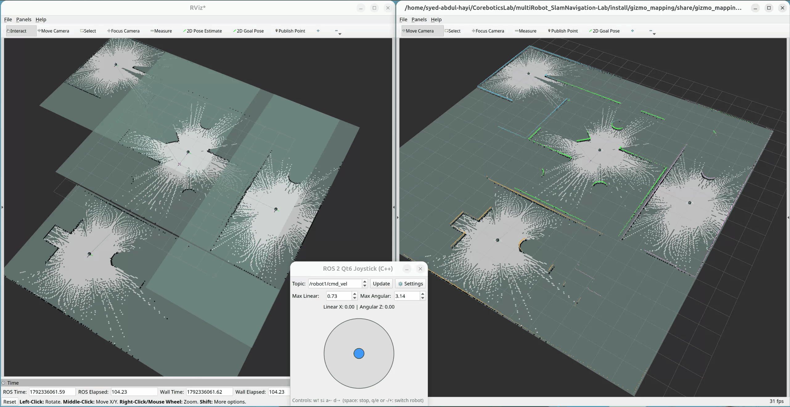
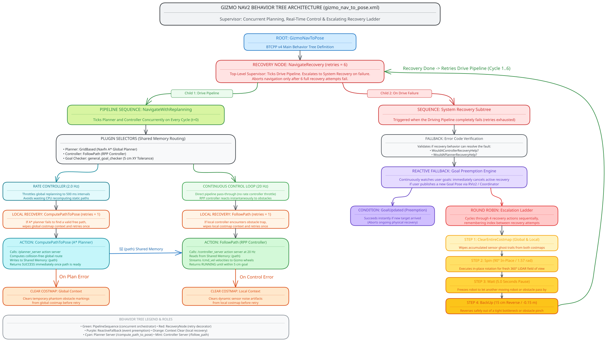

# Multi-Robot Fleet Management & Navigation Lab

Welcome to the **Multi-Robot Fleet Management & Navigation Lab** workspace. This repository contains an end-to-end multi-robot autonomous system built on ROS 2, Gazebo Sim, SLAM Toolbox, Nav2, and custom Behavior Trees.

---

## Environment & Build Setup

This repository uses [Pixi](https://pixi.sh) to manage an isolated, reproducible ROS 2 environment with RoboStack and Gazebo Sim.

```bash
# Clone the repository
git clone https://github.com/CoreBotics-Lab/multiRobot_SlamNavigation-Lab.git
cd multiRobot_SlamNavigation-Lab

# Build the workspace
pixi run colcon build --symlink-install

# Enter the isolated environment
pixi shell
```

> **Note**: CycloneDDS (`rmw_cyclonedds_cpp`) is configured via `src/gizmo_bringup/config/cyclonedds.xml` to prevent discovery storms and local service timeouts across multi-robot namespaces.

---

## 1. Multi-Robot Simultaneous Mapping (SLAM)

The mapping stack enables multiple robots to independently explore and map unknown environments simultaneously using LiDAR-based SLAM.

### Architecture Overview
- **Per-Robot Namespaced SLAM**: Each robot runs an isolated asynchronous `slam_toolbox` instance (`/{NAME}/slam_toolbox`) publishing to `/{NAME}/map`.
- **State Estimation**: Fuses wheel odometry (`/{NAME}/wheel_odom`) and IMU (`/{NAME}/imu/data`) through an Extended Kalman Filter (`robot_localization`) publishing high-rate `odom -> base_footprint` TF.
- **Global Map Merging**: `map_merge_node` subscribes to all `/{NAME}/map` topics, aligns them using fleet spawn offsets, and publishes a unified global occupancy grid on `/map`.

<p align="center">
  
  <br>
  <em>Figure 1: Live Multi-Robot SLAM & Map Merging. Left: Four independent robot map streams running simultaneously. Right: Unified global occupancy grid dynamically merged on <code>/map</code>.</em>
</p>

### Launching Mapping

To launch the complete simulation, multi-robot SLAM stack, and RViz dashboard:

```bash
# Launch mapping for all robots in the fleet
ros2 launch gizmo_bringup multi_robot_mapping.launch.py

# Launch mapping for specific robots (e.g., robot1 and robot2 only)
ros2 launch gizmo_bringup multi_robot_mapping.launch.py robot_names:="robot1,robot2"

# Headless mode (no Gazebo GUI, saves GPU/CPU resources)
ros2 launch gizmo_bringup multi_robot_mapping.launch.py headless:=true
```

### Launch Arguments

| Argument | Default | Description |
| :--- | :--- | :--- |
| `robot_names` | `all` | Comma-separated robot names (e.g. `robot1,robot2`) or `all` |
| `fleet_config` | `robots_fleet.yaml` | Path to fleet configuration defining spawn poses `(x, y, yaw)` |
| `headless` | `false` | Run Gazebo in headless mode |
| `run_rviz2` | `true` | Launch RViz2 pre-configured for multi-robot SLAM visualization |
| `run_teleop` | `true` | Launch the teleoperation interface for driving the robots |
| `gazebo_delay` | `7.0` | Startup grace period (seconds) for Gazebo to load before launching SLAM |

### Teleoperation Controls
- **Drive Controls**: `W` (Forward), `S` (Backward), `A` (Turn Left), `D` (Turn Right), `Space` (Emergency Stop)
- **Robot Switching**:
  - `Q` or `-` : Switch to **previous** robot in the fleet
  - `E` or `+` / `=` : Switch to **next** robot in the fleet
  - Or click the **up/down stepper arrows** directly inside the `Topic:` input box
- **Mouse Control**: Drag the virtual joystick knob with your mouse for proportional velocity control
- **Speed Limits**: Adjust *Max Linear* and *Max Angular* limits dynamically from the GUI or settings drawer

### Saving the Generated Map

Once the environment has been fully explored:

```bash
# Save the unified global map (default map used by Nav2)
ros2 run nav2_map_server map_saver_cli -f src/gizmo_mapping/maps/simple_bigger_world_map --ros-args -p map_topic:=/map

# Save an individual robot's local map (optional)
ros2 run nav2_map_server map_saver_cli -f src/gizmo_mapping/maps/robot1_map --ros-args -p map_topic:=/robot1/map
```

---

## 2. Multi-Robot Autonomous Navigation (Nav2)

The navigation stack coordinates autonomous multi-agent navigation across a shared global map using namespaced Nav2 stacks, custom Behavior Trees, and an intelligent fleet task allocator.

<p align="center">
  
  <br>
  <em>Figure 2: Multi-Robot Nav2 Autonomous Fleet Navigation. Demonstrating asynchronous goal queuing, intelligent task dispatching via the Fleet Goal Allocator, dynamic costmap-based obstacle avoidance, and decentralized RPP path tracking across a shared global map.</em>
</p>

### Namespaced Node Architecture

Each robot in the fleet operates within its own dedicated namespace (`/{NAME}/`) running an isolated Nav2 navigation stack:

- **Planner Server (`nav2_planner::PlannerServer`)**:
  - Implements global path planning using the `nav2_navfn_planner::NavfnPlanner` plugin with A* heuristic search.
  - Evaluates the 2D Global Costmap (static map layer + obstacle inflation) and publishes collision-free paths via the `/{NAME}/compute_path_to_pose` action interface.
- **Controller Server (`nav2_controller::ControllerServer`)**:
  - Implements high-rate (20 Hz) local path tracking using `nav2_regulated_pure_pursuit_controller::RegulatedPurePursuitController` (RPP).
  - Subscribes to the `/{NAME}/follow_path` action server, using adaptive lookahead distance and curvature velocity regulation to slow down on sharp turns and anticipate forward collisions on the Local Costmap.
  - Publishes real-time velocity commands directly to `/{NAME}/cmd_vel`.
- **Behavior Server (`nav2_behaviors::BehaviorServer`)**:
  - Hosts dedicated recovery and contingency action servers (`/{NAME}/clear_costmap`, `/{NAME}/spin`, `/{NAME}/wait`, and `/{NAME}/backup`).
  - Executed whenever the planner fails to find a valid route or the controller detects an impending blockage.
- **BT Navigator (`nav2_bt_navigator::BtNavigator`)**:
  - The central coordinator node hosting the `/{NAME}/navigate_to_pose` action server.
  - Orchestrates the Planner, Controller, and Behavior servers by evaluating the custom XML behavior tree (`gizmo_nav_to_pose.xml`) at runtime.
- **Lifecycle Manager (`nav2_lifecycle_manager::LifecycleManager`)**:
  - Deterministically transitions all managed navigation nodes (`planner_server`, `controller_server`, `behavior_server`, `bt_navigator`) through ROS 2 lifecycle states (`Unconfigured` -> `Inactive` -> `Active`).
  - Establishes heartbeat bonds to monitor node health and ensures navigation nodes only activate after AMCL localization has stabilized coordinate frames.

### Behavior Tree Orchestration (`gizmo_nav_to_pose.xml`)

The custom behavior tree binds the Planner, Controller, and Behavior servers into a robust, self-healing execution pipeline:

<p align="center">
  
</p>

1. **Concurrent Planning and Control (`PipelineSequence`)**:
   - Executes global path computation and local path tracking in parallel.
   - A `RateController` continuously triggers the **Planner Server** at 2.0 Hz to replan around transient dynamic obstacles.
   - The **Controller Server** tracks the latest path segment to maintain smooth continuous motion.
2. **Multi-Stage Recovery Pipeline (`ReactiveFallback` / `RecoveryNode`)**:
   - If planning or path tracking encounters an obstacle deadlock, execution automatically triggers the **Behavior Server**:
     - **Stage 1 (Costmap Clear)**: Clears transient dynamic obstacles from the local costmap.
     - **Stage 2 (In-Place Spin)**: Executes a 90-degree rotation to widen LiDAR scan visibility and eliminate blind spots.
     - **Stage 3 (Wait)**: Pauses velocity commands for 5.0 seconds to yield right-of-way and let crossing fleet robots pass.
     - **Stage 4 (BackUp)**: Reverses the robot by -0.15 m to safely dislodge from tight pinch points.

### Fleet Goal Allocator (`fleet_goal_allocator.py`)
- Centralized dispatcher that listens to the global `/goal_pose` topic (e.g. from RViz *2D Goal Pose* tool).
- **Asynchronous Goal Queuing**: Incoming target goals are buffered into an internal FIFO queue (`goal_queue`), allowing operators to continuously queue multiple targets without stalling or dropping goals while robots are actively executing tasks.
- **Dynamic Queue Processing**: Periodically evaluates idle robots (`isTaskComplete()`), querying true path length (`getPath()`) from Nav2 rather than naive Euclidean distance.
- **Footprint Collision Rejection**: Automatically verifies goal validity, rejecting targets placed within collision threshold of existing robot resting positions, and dispatches each queued goal to the optimal available robot with the shortest feasible path.

### Launching Navigation

```bash
# Launch multi-robot navigation for all robots with RViz and Fleet Goal Allocator
ros2 launch gizmo_bringup multi_robot_navigation.launch.py

# Launch navigation for specific robots
ros2 launch gizmo_bringup multi_robot_navigation.launch.py robot_names:="robot1,robot2"

# Use a custom map file
ros2 launch gizmo_bringup multi_robot_navigation.launch.py map:=/path/to/my_map.yaml
```

### Launch Arguments

| Argument | Default | Description |
| :--- | :--- | :--- |
| `robot_names` | `all` | Comma-separated robot names or `all` |
| `map` | `simple_bigger_world_map.yaml` | Path to the map `.yaml` file |
| `fleet_config` | `robots_fleet.yaml` | Path to fleet configuration defining initial spawn poses |
| `headless` | `false` | Run Gazebo in headless mode |
| `run_rviz2` | `true` | Launch RViz2 pre-configured with multi-robot Nav2 displays |
| `run_allocator`| `true` | Automatically start the Fleet Goal Allocator node |
| `gazebo_delay` | `7.0` | Seconds to wait for Gazebo spawn before launching Nav2 |
| `allocator_delay` | `3.0` | Seconds to wait after Nav2 startup before starting the allocator |

### Dispatching Goals to the Fleet

You can dispatch goals using either RViz or the ROS 2 CLI:

1. **Via RViz2**:
   - Click the **2D Goal Pose** tool in the RViz toolbar.
   - Click and drag anywhere on the map to set the target position and orientation.
   - The **Fleet Goal Allocator** automatically calculates feasible paths for all idle robots and assigns the goal to the closest available robot.

2. **Via Command Line**:
   ```bash
   # Send a goal to the fleet allocator
   ros2 topic pub --once /goal_pose geometry_msgs/msg/PoseStamped '{
     header: {frame_id: "map"},
     pose: {position: {x: 2.5, y: 1.0, z: 0.0}, orientation: {w: 1.0}}
   }'

   # Or send a goal directly to a specific robot's Nav2 action server
   ros2 action send_goal /robot1/navigate_to_pose nav2_msgs/action/NavigateToPose '{
     pose: {header: {frame_id: "map"}, pose: {position: {x: 2.0, y: 3.0, z: 0.0}, orientation: {w: 1.0}}}
   }'
   ```

---

## 3. Theoretical Foundations & Control Architecture

To ensure deterministic multi-agent behavior and reproducible state estimation, the system implements formal kinematic, localization, and control models:

### Nonholonomic Kinematics & Coordinate Frames
Each Gizmo agent operates under a **nonholonomic differential-drive (unicycle) kinematic model** subject to pure rolling and no-slip constraints:

$$
\begin{bmatrix}
\dot{x} \\
\dot{y} \\
\dot{\theta}
\end{bmatrix}
=
\begin{bmatrix}
\cos\theta & 0 \\
\sin\theta & 0 \\
0 & 1
\end{bmatrix}
\begin{bmatrix}
v \\
\omega
\end{bmatrix}
$$

Spatial coordinate frames strictly conform to **REP-105** (Metric Coordinate Frames for Mobile Platforms):
- `map`: Global, earth-fixed world frame. Discrete drift corrections are published by `slam_toolbox` or `amcl` to maintain global consistency.
- `odom`: Continuous, locally smooth, high-rate (50 Hz) odometry frame generated by Extended Kalman Filter (`robot_localization`) fusing wheel kinematics and IMU angular velocities.
- `base_footprint`: 2D ground projection of the mobile base center of rotation.
- `base_link`: Rigidly attached 3D coordinate origin of the vehicle chassis.

```text
map ──(discrete SLAM/AMCL correction update)──> {NAME}/odom ──(continuous EKF)──> {NAME}/base_footprint ──> {NAME}/base_link
```

### Local Control: Regulated Pure Pursuit (RPP) vs. DWB
Rather than evaluating a discrete grid of trajectory rollouts via the Dynamic Window Approach (DWB)—which introduces heuristic scoring instabilities in narrow corridors—local path tracking is handled by the **Regulated Pure Pursuit (RPP)** controller:

1. **Path Curvature Computation**: The controller dynamically extracts an adaptive lookahead point on the global path at distance $L$ and determines target path curvature:

   $$
   \kappa = \frac{2 \sin \alpha}{L}
   $$

   where $\alpha$ is the vehicle heading error relative to the lookahead vector.

2. **Adaptive Velocity Regulation**: Forward velocity is strictly constrained as an inverse function of instantaneous curvature and proximity to dynamic obstacles:

   $$
   v = \frac{v_{\text{max}}}{1 + k \cdot |\kappa|}
   $$

   This guarantees asymptotic convergence to the planned global path, prevents nonholonomic overshoot on sharp turns, and stabilizes multi-robot passing maneuvers.

### Graph-Based SLAM & Rigid 2D Map Alignment
- **Pose-Graph Optimization**: Each robot executes asynchronous 2D LiDAR SLAM via `slam_toolbox`, constructing a dynamic pose graph where nodes denote 2D robot poses $x_i = [x, y, \theta]^T$ and edges denote spatial constraints derived from scan-to-scan correlative scan matching:

  $$
  F(x) = \sum_{ij} e(x_i, x_j, z_{ij})^T \Omega_{ij} \, e(x_i, x_j, z_{ij})
  $$

  Loop closures and constraint graphs are optimized using Ceres non-linear least-squares.

- **Global Map Merging**: Submaps generated under local origins are aligned into a common global coordinate system via rigid 2D planar transformations:

  $$
  T_{\text{global}} = T_{\text{spawn}} \cdot T_{\text{local}}
  $$

  This avoids costly iterative scan correlation across fleets by leveraging deterministic fleet spawn kinematics.

---

## Repository Structure

```text
├── bash_scripts/          # Environment activation and build helpers
├── media/                 # System demonstration recordings and GIFs
├── notes/                 # System architecture diagrams (.excalidraw.svg)
├── src/
│   ├── gizmo_bringup/     # Top-level launch files for mapping, navigation, and DDS config
│   ├── gizmo_description/ # Gizmo differential-drive robot URDF/Xacro and sensors
│   ├── gizmo_gazebo/      # Gazebo simulation worlds, fleet YAML, and EKF config
│   ├── gizmo_mapping/     # SLAM Toolbox configs, map merge node, and saved maps
│   ├── gizmo_navigation/  # Nav2 parameters, custom Behavior Trees, and RViz configs
│   ├── gizmo_scripts/     # Fleet goal allocator node and high-level mission scripts
│   └── gizmo_teleop/      # Teleoperation node for manual fleet control
├── pixi.toml              # Pixi environment and dependency configuration
└── README.md
```
