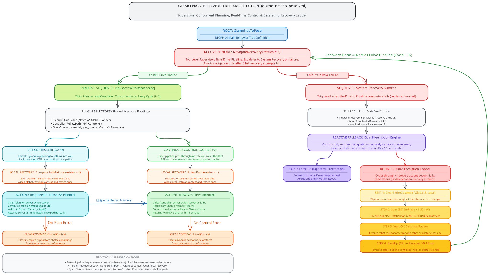

# Multi-Robot Fleet SLAM & Autonomous Navigation Lab (`multiRobot_SlamNavigation-Lab`)

An autonomous mobile robotics engineering repository for **Multi-Robot 2D Graph SLAM**, **Occupancy Grid Map Merging**, **Namespaced Nav2 Autonomous Fleet Navigation**, and **Decentralized Task Allocation** on the **Gizmo 2WD Differential Drive Robot** using **ROS 2 Lyrical** and **CycloneDDS**.

---

## Quickstart Guide

### 1. Build the Workspace
Build all workspace packages using Pixi:
```bash
pixi run colcon build --symlink-install
```

> **Note**: CycloneDDS (`rmw_cyclonedds_cpp`) is configured via `dds_config/cyclonedds.xml` to isolate discovery domains and eliminate multicast discovery storms across multi-robot namespaces.

---

### 2. Multi-Robot Simultaneous Mapping and Map Merging (Mapping Mode)
Launch the complete simulation, namespaced SLAM Toolbox instances, and dynamic map merge node:
```bash
ros2 launch gizmo_bringup multi_robot_mapping.launch.py
```
* When RViz opens, each robot publishes its local occupancy grid (`/{NAME}/map`).
* The `map_merge_node` dynamically transforms and fuses all local submaps into a unified global occupancy grid on `/map`.
* Drive individual robots using the teleoperation interface launched automatically with mapping (or run standalone via `ros2 launch gizmo_teleop teleop.launch.py`) using `W/A/S/D` to drive and `Q`/`E` or the Topic selector to switch between active robots in the fleet.
* *(Note: Gazebo can be executed in headless mode with `headless:=true` to eliminate GUI rendering overhead during multi-agent simulation, as shown in the demonstration).*
* *(Optional)* To save the merged global map or individual submaps once the arena is fully mapped:
  ```bash
  # Save the unified global map (used by Nav2)
  ros2 run nav2_map_server map_saver_cli -f src/gizmo_mapping/maps/simple_bigger_world_map --ros-args -p map_topic:=/map

  # Save an individual robot's local map
  ros2 run nav2_map_server map_saver_cli -f src/gizmo_mapping/maps/robot1_map --ros-args -p map_topic:=/robot1/map
  ```

<p align="center">
  
  <br>
  <em>Figure 1: Live Multi-Robot SLAM and Map Merging (demonstrated with Gazebo running in headless mode). Multiple autonomous agents explore the environment in parallel while Karto-based graph SLAM solvers optimize local pose graphs. The global map merging node dynamically transforms and stitches namespaced occupancy grids into a unified /map representation.</em>
</p>

---

### 3. Multi-Robot Autonomous Fleet Navigation & Goal Allocation (Navigation Mode)
Launch multi-robot Nav2 autonomous navigation with the centralized Fleet Goal Allocator:
```bash
ros2 launch gizmo_bringup multi_robot_navigation.launch.py
```
* When RViz opens, select the **2D Goal Pose** tool on the top toolbar and click anywhere on the global map.
* The **Fleet Goal Allocator** intercepts the target pose, computes feasible Nav2 global paths across all available idle robots, and dispatches the task to the optimal agent with the shortest path.
* Incoming goals placed while all robots are busy are automatically held in an asynchronous FIFO queue and dispatched as robots finish their tasks.
* *(Note: Gazebo can be executed in headless mode with `headless:=true` to eliminate GUI rendering overhead during multi-agent simulation, as shown in the demonstration).*

<p align="center">
  
  <br>
  <em>Figure 2: Multi-Robot Nav2 Autonomous Fleet Navigation (demonstrated with Gazebo running in headless mode). Demonstrating asynchronous goal queuing, intelligent task dispatching via the Fleet Goal Allocator, dynamic costmap-based obstacle avoidance, and decentralized Regulated Pure Pursuit (RPP) path tracking across a shared global map.</em>
</p>

Dispatching goals via the ROS 2 command line:
```bash
# Publish a target pose to the Fleet Goal Allocator
ros2 topic pub --once /goal_pose geometry_msgs/msg/PoseStamped '{
  header: {frame_id: "map"},
  pose: {position: {x: 2.5, y: 1.0, z: 0.0}, orientation: {w: 1.0}}
}'

# Or command a specific robot directly via its Nav2 action interface
ros2 action send_goal /robot1/navigate_to_pose nav2_msgs/action/NavigateToPose '{
  pose: {header: {frame_id: "map"}, pose: {position: {x: 2.0, y: 3.0, z: 0.0}, orientation: {w: 1.0}}}
}'
```

---

## Architectural Overview

The multi-robot architecture provides namespaced decentralization for high-rate perception, state estimation, and path tracking, combined with centralized fleet orchestration for global map merging and goal dispatching:

```text
                                [Fleet Operator / RViz2 Dashboard]
                                                │
                       ┌────────────────────────┴────────────────────────┐
                       │ (/goal_pose)                                    │ (Display streams)
                       ▼                                                 ▼
             [fleet_goal_allocator]                             [rviz2_dashboard]
             (Dynamic FIFO Queue &                               (Namespaced TF,
              Shortest Path Dispatch)                             Paths, & Costmaps)
                       │
       ┌───────────────┼───────────────┐ (Action Dispatch: /{NAME}/navigate_to_pose)
       ▼                               ▼
 [robot1 Namespace]             [robot2 Namespace]             [robotN Namespace]
┌─────────────────────────┐    ┌─────────────────────────┐    ┌─────────────────────────┐
│ • bt_navigator          │    │ • bt_navigator          │    │ • bt_navigator          │
│ • planner_server (NavFn)│    │ • planner_server (NavFn)│    │ • planner_server (NavFn)│
│ • controller_server(RPP)│    │ • controller_server(RPP)│    │ • controller_server(RPP)│
│ • behavior_server       │    │ • behavior_server       │    │ • behavior_server       │
│ • slam_toolbox / amcl   │    │ • slam_toolbox / amcl   │    │ • slam_toolbox / amcl   │
└────────────┬────────────┘    └────────────┬────────────┘    └────────────┬────────────┘
             │ /{NAME}/map                  │ /{NAME}/map                  │ /{NAME}/map
             └──────────────────────┬───────┴──────────────────────────────┘
                                    ▼
                            [map_merge_node]
                     (Rigid 2D Planar Alignment)
                                    │
                                    ▼
                         Unified Global Map (/map)
```

### Behavior Tree Execution Architecture (`gizmo_nav_to_pose.xml`)

Each robot evaluates a dedicated Behavior Tree coordinating path planning, tracking, and recovery:

<p align="center">
  
</p>

* **Concurrent Planning and Control (`PipelineSequence`)**: Continuously evaluates global route replanning at 2.0 Hz while the controller tracks the active path segment at 20.0 Hz.
* **Deterministic Fallback Recovery (`RecoveryNode`)**: When deadlocks or dynamic obstacles occur, the Behavior Server steps through clear-costmap, in-place spin (to broaden LiDAR perception), 5-second wait (yielding right-of-way to crossing fleet agents), and linear backup maneuvers.

---

## Workspace Packages

The repository is organized into 7 modular ROS 2 packages inside `src/`:

| Package | Build Type | Primary Responsibility |
| :--- | :--- | :--- |
| **`gizmo_description`** | `ament_cmake` | Robot kinematics URDF/Xacro, visual and collision geometry, inertial parameters, and sensor frame definitions. |
| **`gizmo_gazebo`** | `ament_cmake` | Gazebo simulation worlds (`simpleBiggerWorld.sdf`), fleet configuration (`robots_fleet.yaml`), and multi-robot entity spawners. |
| **`gizmo_teleop`** | `ament_cmake` | Teleoperation node with dynamic multi-robot topic switching, safety clamping, and proportional joystick controls. |
| **`gizmo_mapping`** | `ament_cmake` | Namespaced SLAM Toolbox configurations, 2D occupancy grid maps, and real-time rigid map merge node (`map_merge_node.py`). |
| **`gizmo_navigation`** | `ament_cmake` | Namespaced Nav2 parameter files (`nav2_namespaced.yaml`), custom Behavior Trees (`gizmo_nav_to_pose.xml`), and multi-robot RViz dashboards. |
| **`gizmo_bringup`** | `ament_cmake` | Top-level system orchestrators coordinating simulation, namespaced mapping, and multi-robot autonomous navigation. |
| **`gizmo_scripts`** | `ament_python` | Centralized Fleet Goal Allocator (`fleet_goal_allocator.py`) supporting asynchronous goal queuing, path length optimization, and footprint clearance checks. |

---

## Launch Architecture

The workspace provides launch pipelines structured across 3 architectural layers:

```text
[Layer 3: Master Bringup & Fleet Orchestration]
  ├── multi_robot_mapping.launch.py    (Full simulation + Namespaced SLAM + Map Merge + Teleop + RViz2)
  ├── multi_robot_navigation.launch.py (Full simulation + Namespaced Nav2 + Fleet Goal Allocator + RViz2)
  ├── single_robot_mapping.launch.py   (Single-agent SLAM baseline)
  └── single_robot_navigation.launch.py(Single-agent Nav2 baseline)

[Layer 2: Core Subsystems]
  ├── multi_robot_slam.launch.py       (Dynamic loop spawning isolated slam_toolbox instances per robot)
  ├── map_merge.launch.py              (Dynamic rigid 2D alignment fusing /{NAME}/map into /map)
  └── navigation.launch.py             (Namespaced 4-server Nav2 stack + lifecycle managers)

[Layer 1: Simulation & Kinematics]
  ├── gazebo_multi_robot_spawn.launch.py (Gazebo simulator + fleet entity spawners + clock/sensor bridges)
  ├── gazebo.launch.py                   (Single-robot base simulator spawner)
  ├── display.launch.py                  (URDF kinematic transform tree verification in RViz)
  └── teleop.launch.py                   (Interactive velocity command publisher)
```

---

### Layer 3: Master Bringup & Fleet Orchestration

#### 1. `multi_robot_mapping.launch.py` (`gizmo_bringup`)
* **Purpose**: Coordinates full multi-robot SLAM simulation. Launches Gazebo, spawns fleet robots with sensor bridges, executes namespaced SLAM Toolbox nodes, starts map merging, and brings up the visualization dashboard.
* **Mechanism**:
  1. Spawns Gazebo and fleet entities via `gazebo_multi_robot_spawn.launch.py` based on `robots_fleet.yaml`.
  2. Applies a `TimerAction(period=gazebo_delay)` (default 7.0s) allowing Gazebo physics, sensor topics, and EKF transforms to stabilize.
  3. Launches namespaced `slam_toolbox` instances for all active agents via `multi_robot_slam.launch.py`.
  4. Launches `map_merge_node.py` to aggregate submaps into `/map`.
  5. Spawns RViz2 configured with multi-robot occupancy displays and the multi-topic teleoperation interface.
* **Key Commands**:
  ```bash
  # Launch mapping for all robots in the fleet
  ros2 launch gizmo_bringup multi_robot_mapping.launch.py

  # Launch mapping for a subset of robots
  ros2 launch gizmo_bringup multi_robot_mapping.launch.py robot_names:="robot1,robot2"

  # Headless mode (no Gazebo GUI, reduces CPU/GPU overhead)
  ros2 launch gizmo_bringup multi_robot_mapping.launch.py headless:=true
  ```

---

#### 2. `multi_robot_navigation.launch.py` (`gizmo_bringup`)
* **Purpose**: Coordinates multi-robot autonomous navigation across a shared pre-built map.
* **Mechanism**:
  1. Launches Gazebo physics and spawns fleet robots at predefined initial coordinates.
  2. Waits for Gazebo initialization (`gazebo_delay:=7.0`), then initializes namespaced Nav2 stacks (`planner_server`, `controller_server`, `behavior_server`, `bt_navigator`) for each robot.
  3. Launches the **Fleet Goal Allocator** after Nav2 servers transition to active (`allocator_delay:=3.0`).
  4. Launches RViz2 with multi-robot costmaps, local plans, and goal injection tools.
* **Key Commands**:
  ```bash
  # Launch multi-robot navigation for the entire fleet
  ros2 launch gizmo_bringup multi_robot_navigation.launch.py

  # Launch navigation with a custom pre-built map
  ros2 launch gizmo_bringup multi_robot_navigation.launch.py map:=/path/to/my_map.yaml

  # Launch navigation for specific robots only
  ros2 launch gizmo_bringup multi_robot_navigation.launch.py robot_names:="robot1,robot2"
  ```

---

### Layer 2: Core Subsystems

#### 3. `multi_robot_slam.launch.py` (`gizmo_mapping`)
* **Purpose**: Spawns isolated, namespaced SLAM Toolbox instances for each designated robot.
* **Mechanism**: Parses `robots_fleet.yaml`, generates a temporary parameter file for each robot replacing `{NAME}` tokens, and remaps local `map` and `map_metadata` topics to prevent cross-namespace collision.

#### 4. `map_merge.launch.py` (`gizmo_mapping`)
* **Purpose**: Aggregates distributed submaps into a coherent global occupancy grid.
* **Mechanism**: Subscribes to `/{NAME}/map` updates, projects submap occupancy data onto the global `/map` frame using rigid planar spawn transformations, and resolves conflicting cell states via probabilistic occupancy fusion.

#### 5. `fleet_goal_allocator.py` (`gizmo_scripts`)
* **Purpose**: High-level decentralized goal dispatcher and priority queue manager.
* **Mechanism**:
  * Subscribes to global `/goal_pose` inputs.
  * Rejects candidate goals placed within robot collision clearance zones.
  * Queries actual Nav2 plan lengths (`getPath()`) from idle candidates rather than naive Euclidean distance.
  * Dispatches target goals to the optimal candidate and buffers excess requests in a thread-safe FIFO queue.

---

### Layer 1: Simulation & Kinematics

#### 6. `gazebo_multi_robot_spawn.launch.py` (`gizmo_gazebo`)
* **Purpose**: Base physics simulation engine and fleet entity spawning pipeline.
* **Mechanism**: Starts Gazebo Sim, loads the designated world (`simpleBiggerWorld.sdf`), initializes bidirectional `/clock` and sensor bridges (`/scan`, `/imu/data`), publishes robot URDF models via `robot_state_publisher`, and executes namespaced EKF nodes (`robot_localization`).

#### 7. `teleop.launch.py` (`gizmo_teleop`)
* **Purpose**: Standalone velocity command teleoperation interface with dynamic topic switching.
* **Mechanism**: Spawns the joystick teleoperation interface for manual velocity command injection with safety limits (`max_linear: 0.73` m/s, `max_angular: 3.14` rad/s), keyboard driving (`W/A/S/D`), and fleet robot switching (`Q`/`E` or Topic spinbox).
* **Command**:
  ```bash
  # Launch teleoperation interface for manual driving
  ros2 launch gizmo_teleop teleop.launch.py
  ```

---

## Theoretical Foundations & Control Architecture

### Nonholonomic Kinematics & Coordinate Frames
Each Gizmo robot operates under differential-drive nonholonomic kinematic constraints with pure rolling and zero lateral slip:

$$
\begin{bmatrix}
\dot{x} \\
\dot{y} \\
\dot{\theta}
\end{bmatrix} =
\begin{bmatrix}
\cos\theta & 0 \\
\sin\theta & 0 \\
0 & 1
\end{bmatrix}
\begin{bmatrix}
v \\
\omega
\end{bmatrix}
$$

Spatial coordinate frames strictly conform to **REP-105**:
* `map`: Earth-fixed global world frame shared across the fleet.
* `{NAME}/odom`: Continuous, locally smooth odometry frame estimated by Extended Kalman Filter (`robot_localization`) fusing wheel kinematics and IMU sensor streams.
* `{NAME}/base_footprint`: 2D ground projection of the mobile robot center of rotation.
* `{NAME}/base_link`: Rigidly attached 3D origin of the vehicle chassis.

```text
map ──(discrete SLAM/AMCL update)──> {NAME}/odom ──(continuous EKF)──> {NAME}/base_footprint ──> {NAME}/base_link
```

---

### Path Tracking & Velocity Regulation (Regulated Pure Pursuit)
To prevent control instability in narrow corridors and tight passages, local trajectory tracking is governed by the **Regulated Pure Pursuit (RPP)** controller:

**Target Path Curvature**:
The controller continuously extracts a lookahead point on the global path at distance $L$ and computes the circular arc curvature:

$$
\kappa = \frac{2 \sin \alpha}{L}
$$

where $\alpha$ is the heading error between the vehicle orientation and the lookahead vector.

**Adaptive Curvature Regulation**:
Linear velocity is regulated dynamically as an inverse function of instantaneous curvature:

$$
v = \frac{v_{\text{max}}}{1 + k \cdot |\kappa|}
$$

This guarantees bounded lateral acceleration on tight corners, prevents path overshoot, and stabilizes multi-agent intersection clearance.

---

### Rigid 2D Planar Map Merging & Pose-Graph Optimization
**Pose-Graph SLAM**:
Each robot runs asynchronous 2D LiDAR SLAM via `slam_toolbox`, constructing a dynamic pose graph where nodes denote 2D vehicle poses $x_i = [x, y, \theta]^T$ and edges denote spatial constraints from scan matching:

$$
F(x) = \sum_{ij} e(x_i, x_j, z_{ij})^T \Omega_{ij} \, e(x_i, x_j, z_{ij})
$$

Loop closures and constraint graphs are optimized using Ceres non-linear least squares.

**Deterministic Map Alignment**:
Because fleet initial spawn coordinates are known from `robots_fleet.yaml`, local submaps are projected onto the global frame through rigid 2D planar transformations without requiring computationally prohibitive cross-fleet scan matching:

$$
T_{\text{global}} = T_{\text{spawn}} \cdot T_{\text{local}}
$$

---

## Repository Structure

```text
├── bash_scripts/          # Environment activation and build helpers
├── dds_config/            # CycloneDDS configuration (cyclonedds.xml)
├── media/                 # High-fidelity demonstration recordings and GIFs
├── notes/                 # System architecture diagrams (.excalidraw.svg)
├── src/
│   ├── gizmo_bringup/     # Master launch files for fleet mapping and navigation
│   ├── gizmo_description/ # Differential-drive URDF/Xacro models and sensor frames
│   ├── gizmo_gazebo/      # Simulation worlds, fleet spawn configs, and bridges
│   ├── gizmo_mapping/     # Namespaced SLAM configs and rigid map merge node
│   ├── gizmo_navigation/  # Nav2 parameters, custom Behavior Trees, and RViz configs
│   ├── gizmo_scripts/     # Centralized Fleet Goal Allocator and task dispatchers
│   └── gizmo_teleop/      # Multi-robot teleoperation GUI node
├── pixi.toml              # Pixi environment and dependency specification
└── README.md
```
